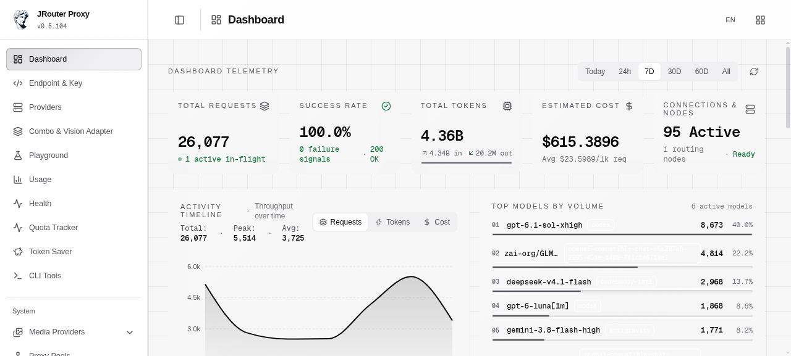
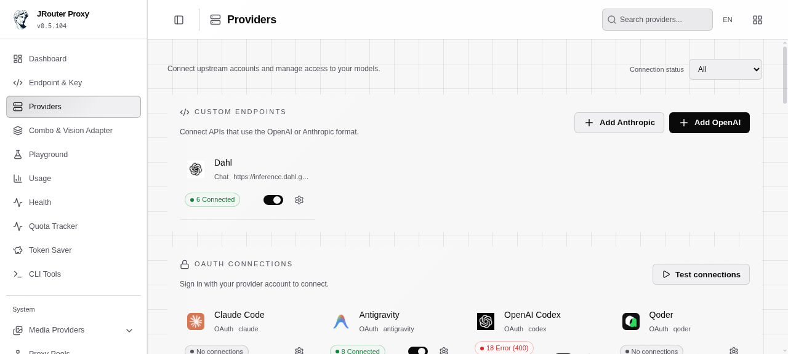
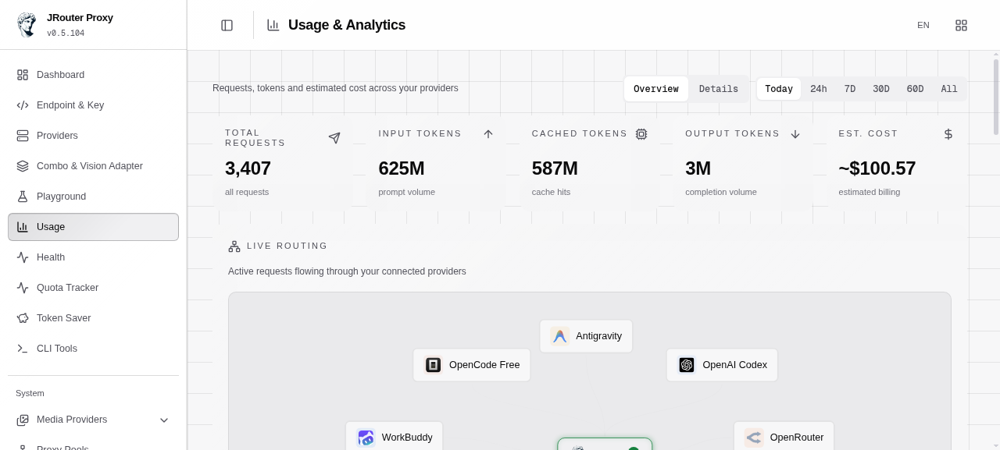
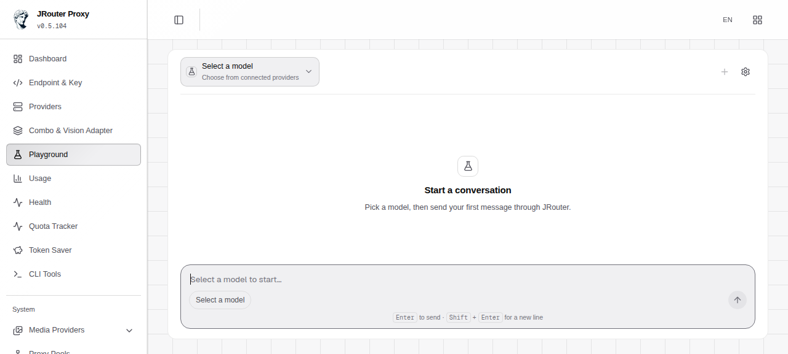

<div align="center">
  
  
  # JRouter - AI Router & Token Saver
  
  **Never stop coding. Save 20-40% tokens with RTK + auto-fallback to free & cheap AI models.**
  
  **Connect All AI Code Tools (Claude Code, Cursor, Antigravity, Copilot, Codex, Gemini, OpenCode, Cline, OpenClaw...) to 40+ AI Providers & 100+ Models.**
  
  [](https://www.npmjs.com/package/@synthever/jrouter)
  [](./LICENSE)

  [🚀 Quick Start](#-quick-start) • [💡 Features](#-key-features) • [📖 Setup Guide](#-setup-guide) • [📸 Screenshots](#-screenshots)

</div>

---

> **JRouter is a maintained fork of [9Router](https://github.com/decolua/9router)** by [decolua](https://github.com/decolua) — all credit for the original architecture goes upstream. JRouter adds: **WorkBuddy & River providers**, model-namespace guards, orphan-model cleanup, **backup/restore of enabled-model settings**, **API-key extraction & bulk JSON import**, per-key model restrictions, and an installable CLI (`npm i -g @synthever/jrouter`).

## 📸 Screenshots

<div align="center">
  
  <p><b>Dashboard</b> — real-time telemetry: requests, tokens, success rate, live routing & estimated cost</p>

  
  <p><b>Providers</b> — connection status and live model routing across all upstream accounts</p>

  
  <p><b>Usage & Analytics</b> — requests, tokens and estimated cost across providers over time</p>

  
  <p><b>Playground</b> — chat with any connected model instantly</p>
</div>

---

## 🤔 Why JRouter?

**Stop wasting money, tokens and hitting limits:**

- ❌ Subscription quota expires unused every month
- ❌ Rate limits stop you mid-coding
- ❌ Tool outputs (git diff, grep, ls...) burn tokens fast
- ❌ Expensive APIs ($20-50/month per provider)
- ❌ Manual switching between providers

**JRouter solves this:**

- ✅ **RTK Token Saver** - Auto-compress tool_result content, save 20-40% tokens per request
- ✅ **Maximize subscriptions** - Track quota, use every bit before reset
- ✅ **Auto fallback** - Subscription → Cheap → Free, zero downtime
- ✅ **Multi-account** - Round-robin between accounts per provider
- ✅ **Universal** - Works with Claude Code, Codex, Cursor, Cline, any CLI tool

---

## 🔄 How It Works

```
┌─────────────┐
│  Your CLI   │  (Claude Code, Codex, OpenClaw, Cursor, Cline...)
│   Tool      │
└──────┬──────┘
       │ http://localhost:20128/v1
       ↓
┌─────────────────────────────────────────────┐
│           JRouter (Smart Router)            │
│  • RTK Token Saver (cut tool_result tokens) │
│  • Format translation (OpenAI ↔ Claude)     │
│  • Quota tracking                           │
│  • Auto token refresh                       │
└──────┬──────────────────────────────────────┘
       │
       ├─→ [Tier 1: SUBSCRIPTION] Claude Code, Codex, GitHub Copilot
       │   ↓ quota exhausted
       ├─→ [Tier 2: CHEAP] GLM ($0.6/1M), MiniMax ($0.2/1M)
       │   ↓ budget limit
       └─→ [Tier 3: FREE] Kiro, OpenCode Free, Vertex ($300 credits)

Result: Never stop coding, minimal cost + 20-40% token savings via RTK
```

---

## ⚡ Quick Start

**1. Install globally:**

```bash
npm install -g @synthever/jrouter
jrouter
```

🎉 Dashboard opens at `http://localhost:20128`

**Useful CLI commands:**

```bash
jrouter                    # start the server + open the dashboard
jrouter -p 3000            # run on a custom port
jrouter connect <url>      # configure local CLI tools against a remote JRouter
jrouter show               # show each CLI tool's current JRouter config
```

**2. Connect a FREE provider (no signup needed):**

Dashboard → Providers → Connect **Kiro AI** (~50 credits/month free: Claude 4.5 + GLM-5 + MiniMax) or **OpenCode Free** (no auth) → Done!

**3. Use in your CLI tool:**

```
Claude Code/Codex/OpenClaw/Cursor/Cline Settings:
  Endpoint: http://localhost:20128/v1
  API Key: [copy from dashboard]
  Model: kr/claude-sonnet-4.5
```

**That's it!** Start coding with FREE AI models.

**Alternative: run from source (this repository):**

```bash
cp .env.example .env
npm install
PORT=20128 NEXT_PUBLIC_BASE_URL=http://localhost:20128 npm run dev
```

Production mode:

```bash
export MAKEFLAGS="-j1"

npm run build

PORT=20128 HOSTNAME=0.0.0.0 NEXT_PUBLIC_BASE_URL=http://localhost:20128 npm run start
```

Default URLs:

- Dashboard: `http://localhost:20128/dashboard`
- OpenAI-compatible API: `http://localhost:20128/v1`

---

## Video Guides

Tutorials for the upstream 9Router project (JRouter works the same way):

<div align="center">

<table>
  <tr>
    <td align="center" width="320">
      <a href="https://www.youtube.com/watch?v=CkVZZUSTXAI">
        
      </a><br/>
      <b>🇮🇩 Indonesia</b><br/>
      <sub>Koding 24 Jam Anti Rate Limit! Hemat Token AI 65% | Tutorial Quick Setup 9Router 🚀<br/>by <a href="https://www.youtube.com/@krisswuh">Krisswuh</a></sub>
    </td>
    <td align="center" width="320">
      <a href="https://www.youtube.com/watch?v=TXGv4eofe1I">
        
      </a><br/>
      <b>🇮🇩 Indonesia</b><br/>
      <sub>Cara Deploy 9Router di Hugging Face GRATIS Non-Stop! | Alternatif VPS RAM 16GB<br/>by <a href="https://www.youtube.com/@krisswuh">Krisswuh</a></sub>
    </td>
    <td align="center" width="320">
      <a href="https://www.youtube.com/watch?v=hgnE7MKi3Y4">
        
      </a><br/>
      <b>🇮🇩 Indonesia</b><br/>
      <sub>Bye Limit! Cara Bikin Sistem "AI Unlimited" 100% Gratis Dengan 9Router!<br/>by <a href="https://www.youtube.com/@neptiver">neptiver</a></sub>
    </td>
  </tr>
  <tr>
    <td align="center" width="320">
      <a href="https://www.youtube.com/watch?v=raEyZPg5xE0">
        
      </a><br/>
      <b>🇺🇸 English</b><br/>
      <sub>9Router + Claude Code FREE Setup<br/>by <a href="https://www.youtube.com/@BuildAIWithHamid">Build AI With Hamid</a></sub>
    </td>
    <td align="center" width="320">
      <a href="https://www.youtube.com/watch?v=X69n5Lm06Yw">
        
      </a><br/>
      <b>🇻🇳 Tiếng Việt</b><br/>
      <sub>Tiết kiệm chi phí LLM cho OpenClaw với 9Router<br/>by <a href="https://www.youtube.com/c/M%C3%ACAIblog">Mì AI</a></sub>
    </td>
    <td align="center" width="320"></td>
  </tr>
</table>

</div>

---

## 🛠️ Supported CLI Tools

JRouter works seamlessly with all major AI coding tools:

<div align="center">
  <table>
    <tr>
      <td align="center" width="120">
        <br/>
        <b>Claude-Code</b>
      </td>
      <td align="center" width="120">
        <br/>
        <b>OpenClaw</b>
      </td>
      <td align="center" width="120">
        <br/>
        <b>Codex</b>
      </td>
      <td align="center" width="120">
        <br/>
        <b>OpenCode</b>
      </td>
      <td align="center" width="120">
        <br/>
        <b>Cursor</b>
      </td>
      <td align="center" width="120">
        <br/>
        <b>Antigravity</b>
      </td>
    </tr>
    <tr>
      <td align="center" width="120">
        <br/>
        <b>Cline</b>
      </td>
      <td align="center" width="120">
        <br/>
        <b>Continue</b>
      </td>
      <td align="center" width="120">
        <br/>
        <b>Droid</b>
      </td>
      <td align="center" width="120">
        <br/>
        <b>Roo</b>
      </td>
      <td align="center" width="120">
        <br/>
        <b>Copilot</b>
      </td>
      <td align="center" width="120">
        <br/>
        <b>Kilo Code</b>
      </td>
    </tr>
  </table>
</div>

---

## 🌐 Supported Providers

### 🔐 OAuth Providers

<div align="center">
  <table>
    <tr>
      <td align="center" width="120">
        <br/>
        <b>Claude-Code</b>
      </td>
      <td align="center" width="120">
        <br/>
        <b>Antigravity</b>
      </td>
      <td align="center" width="120">
        <br/>
        <b>Codex</b>
      </td>
      <td align="center" width="120">
        <br/>
        <b>GitHub</b>
      </td>
      <td align="center" width="120">
        <br/>
        <b>WorkBuddy</b>
      </td>
      <td align="center" width="120">
        <br/>
        <b>CodeBuddy</b>
      </td>
    </tr>
  </table>
</div>

### 🆓 Free Providers

<div align="center">
  <table>
    <tr>
      <td align="center" width="150">
        <br/>
        <b>Kiro AI</b><br/>
        <sub>Claude 4.5 + GLM-5 + MiniMax<br/>50 credits/month free</sub>
      </td>
      <td align="center" width="150">
        <br/>
        <b>OpenCode Free</b><br/>
        <sub>No auth • Auto-fetch models<br/>Free (model list varies)</sub>
      </td>
      <td align="center" width="150">
        <br/>
        <b>Vertex AI</b><br/>
        <sub>Gemini 3 Pro + GLM-5 + DeepSeek<br/>$300 credits free</sub>
      </td>
    </tr>
  </table>
</div>

### 🔑 API Key Providers (40+)

<div align="center">
  <table>
    <tr>
      <td align="center" width="100">
        <br/>
        <sub>OpenRouter</sub>
      </td>
      <td align="center" width="100">
        <br/>
        <sub>River</sub>
      </td>
      <td align="center" width="100">
        <br/>
        <sub>GLM</sub>
      </td>
      <td align="center" width="100">
        <br/>
        <sub>Kimi</sub>
      </td>
      <td align="center" width="100">
        <br/>
        <sub>MiniMax</sub>
      </td>
      <td align="center" width="100">
        <br/>
        <sub>OpenAI</sub>
      </td>
    </tr>
    <tr>
      <td align="center" width="100">
        <br/>
        <sub>Anthropic</sub>
      </td>
      <td align="center" width="100">
        <br/>
        <sub>DeepSeek</sub>
      </td>
      <td align="center" width="100">
        <br/>
        <sub>Groq</sub>
      </td>
      <td align="center" width="100">
        <br/>
        <sub>xAI</sub>
      </td>
      <td align="center" width="100">
        <br/>
        <sub>Mistral</sub>
      </td>
      <td align="center" width="100">
        <br/>
        <sub>NVIDIA</sub>
      </td>
    </tr>
  </table>
  <p><i>...and 20+ more including Together, Fireworks, Cerebras, SiliconFlow, and custom OpenAI/Anthropic-compatible endpoints</i></p>
</div>

> **JRouter extras:** `workbuddy` (GLM/DeepSeek/Kimi/MiniMax via workbuddy.ai) and `river` are JRouter additions, plus **bulk key management** — export all connection keys of a provider as JSON (*Extract Keys*) and import them on another provider (*Add Key → Import JSON*).

### 🏠 Self-hosted Providers

For speech and embeddings served from **your own** machine — whisper.cpp,
faster-whisper, Kokoro-FastAPI, openedai-speech, llama.cpp/llama-server,
vLLM, Infinity, or anything else that speaks the OpenAI shape.

| Provider | Endpoint used | Typical server |
| --- | --- | --- |
| **Self-hosted STT** | `/v1/audio/transcriptions` | whisper.cpp, faster-whisper |
| **Self-hosted TTS** | `/v1/audio/speech` | Kokoro-FastAPI, openedai-speech |
| **Self-hosted Embedding** | `/v1/embeddings` | llama-server, vLLM, Infinity |

Each of these reads its address from **each connection** (`providerSpecificData.baseUrl`),
so one provider can front several machines and load-balance across them.

> **Mind the `/v1` on embeddings.** The adapter appends `/embeddings`, so
> `http://host:8080` resolves to `http://host:8080/embeddings` and misses the
> OpenAI route — llama-server answers **501**. Give it the same base URL an OpenAI
> client would use (`http://host:8080/v1`).

The API key is not checked by most local servers, but the field must be non-empty:
it is what gives the connection a credentials record, and `baseUrl` lives there.
Any placeholder works.

---

## 💡 Key Features

| Feature                                                                           | What It Does                                                                             | Why It Matters                                    |
| --------------------------------------------------------------------------------- | ---------------------------------------------------------------------------------------- | ------------------------------------------------- |
| 🚀 **RTK Token Saver** ([RTK](https://github.com/rtk-ai/rtk) ⭐40K)               | Compress tool outputs (`git diff`, `grep`, `ls`, `tree`...) before sending to LLM        | Save **20-40% input tokens** per request          |
| 🪨 **Caveman Mode** ([Caveman](https://github.com/JuliusBrussee/caveman) ⭐52K)   | Inject caveman-speak prompt → LLM replies terse, technical substance preserved           | Save **up to 65% output tokens**                  |
| 🐴 **Ponytail** ([Ponytail](https://github.com/DietrichGebert/ponytail))          | Inject "lazy senior dev" prompt → LLM writes minimal, YAGNI-first code (Lite/Full/Ultra) | **Fewer output tokens, less refactoring**         |
| 🎯 **Smart 3-Tier Fallback**                                                      | Auto-route: Subscription → Cheap → Free                                                  | Never stop coding, zero downtime                  |
| 📊 **Real-Time Quota Tracking**                                                   | Live token count + reset countdown                                                       | Maximize subscription value                       |
| 🔄 **Format Translation**                                                         | OpenAI ↔ Claude ↔ Gemini ↔ Cursor ↔ Kiro ↔ Vertex                                        | Works with any CLI tool                           |
| 👥 **Multi-Account Support**                                                      | Multiple accounts per provider                                                           | Load balancing + redundancy                       |
| 🔄 **Auto Token Refresh**                                                         | OAuth tokens refresh automatically                                                       | No manual re-login needed                         |
| 🔐 **Per-Key Model Restrictions**                                                 | Each API key can restrict allowed models; `/v1/models` reflects the restriction          | Fine-grained access control                       |
| 💾 **Backup/Restore with Model Settings**                                         | Full DB export as JSON **including per-provider enabled/disabled models**                | Restore anywhere, settings come back exactly      |
| 📥 **Key Extract & Import**                                                       | Export connection keys as JSON, bulk-import on another provider                          | Move keys between providers in seconds            |
| 🎨 **Custom Combos**                                                              | Create unlimited model combinations                                                      | Tailor fallback to your needs                     |
| 📊 **Usage Analytics**                                                            | Track tokens, cost, trends over time                                                     | Optimize spending                                 |
| 🌐 **Deploy Anywhere**                                                            | Localhost, VPS, npm CLI                                                                  | Flexible deployment options                       |

Set `X-9Router-Token-Saver: off` to bypass all token savers for one chat request.

<details>
<summary><b>📖 Feature Details</b></summary>

### 🚀 RTK Token Saver

Tool outputs (`git diff`, `grep`, `find`, `ls`, `tree`, log dumps...) often eat 30-50% of your prompt budget. RTK detects them and applies smart, lossless compression **before** the request hits the LLM:

- **Filters:** `git-diff`, `git-status`, `grep`, `find`, `ls`, `tree`, `dedup-log`, `smart-truncate`, `read-numbered`, `search-list`
- **Auto-detect:** No config needed — RTK peeks the first 1KB of each `tool_result` and picks the right filter.
- **Safe by design:** If a filter fails, throws, or makes output bigger, RTK silently keeps the original text. Errors never break your request.
- **Universal:** Works across all formats (OpenAI, Claude, Gemini, Cursor, Kiro, OpenAI Responses) because it runs **before** any format translation.
- **Default ON:** Toggle anytime in Dashboard → Endpoint settings.

```
Without RTK: 47K tokens sent to LLM
With RTK:    28K tokens sent to LLM   (40% saved · same context · same answer)
```

### 🐴 Ponytail (Lazy Senior Dev)

Ponytail injects a _"lazy senior dev"_ system prompt into every request, biasing the LLM toward minimal, YAGNI-first code — deletion over addition, stdlib over new deps, one-liners over abstractions. Adapted from [DietrichGebert/ponytail](https://github.com/DietrichGebert/ponytail).

- **Lite** — Build what's asked, name the lazier alternative.
- **Full** — YAGNI ladder enforced: stdlib → native → existing deps → one-liner → minimal code.
- **Ultra** — YAGNI extremist: deletion first, ship the one-liner, challenge the rest of the requirement in the same response.

```
Without Ponytail: verbose code, extra abstractions, "just in case" scaffolding
With Ponytail:    shortest working diff, no unrequested abstractions, fewer tokens
```

Never trades away: input validation, error handling that prevents data loss, security, accessibility, or anything explicitly requested. Enable in Dashboard → Endpoint → Ponytail. Stacks with Caveman (output terseness) and RTK (input compression).

### 🎯 Smart 3-Tier Fallback

Create combos with automatic fallback:

```
Combo: "my-coding-stack"
  1. cc/claude-opus-4-6        (your subscription)
  2. glm/glm-4.7               (cheap backup, $0.6/1M)
  3. if/kimi-k2-thinking       (free fallback)

→ Auto switches when quota runs out or errors occur
```

### 🔐 Per-Key Model Restrictions

Each API key can have an allowed-models list:

- **Allowed models set** → the key can only use those models, and `GET /v1/models` with that key returns only them
- **Allowed models empty** → the key can use all models

### 💾 Backup / Restore with Model Settings

Download the full database as JSON from Dashboard → Settings. The export includes per-provider **enabled/disabled model lists**, so a restore brings every provider back exactly as configured — no models reset to defaults.

### 📥 Extract Keys & Import JSON

On any API-key provider: **Connections → Extract Keys** downloads `keys-<providerId>.json`. On another provider: **Add Key → Import JSON** parses that file, validates each key, and bulk-adds the active ones.

### 🔄 Format Translation

Seamless translation between formats:

- **OpenAI** ↔ **Claude** ↔ **Gemini** ↔ **Cursor** ↔ **Kiro** ↔ **Vertex** ↔ **Antigravity** ↔ **Ollama** ↔ **OpenAI Responses**
- Your CLI tool sends OpenAI format → JRouter translates → Provider receives native format

### 📊 Real-Time Quota Tracking

- Token consumption per provider
- Reset countdown (5-hour, daily, weekly)
- Cost estimation for paid tiers
- Monthly spending reports

### 👥 Multi-Account Support

- Add multiple accounts per provider
- Auto round-robin or priority-based routing
- Fallback to next account when one hits quota

### 🔄 Auto Token Refresh

- OAuth tokens automatically refresh before expiration
- No manual re-authentication needed

> **💡 IMPORTANT - Understanding Dashboard Costs:**
>
> The "cost" displayed in Usage Analytics is **for tracking and comparison purposes only**.
> JRouter itself **never charges** you anything. You only pay providers directly (if using paid services).
>
> Think of it as a "savings tracker" showing how much you're saving by using free models or
> routing through JRouter!

</details>

---

## 💰 Pricing at a Glance

| Tier                | Provider              | Cost         | Quota Reset      | Best For                                |
| ------------------- | --------------------- | ------------ | ---------------- | --------------------------------------- |
| **🚀 TOKEN SAVER**  | **RTK (built-in)**    | **FREE**     | Always on        | **Save 20-40% tokens on EVERY request** |
| **💳 SUBSCRIPTION** | Claude Code (Pro/Max) | $20-200/mo   | 5h + weekly      | Already subscribed                      |
|                     | Codex (Plus/Pro)      | $20-200/mo   | 5h + weekly      | OpenAI users                            |
|                     | GitHub Copilot        | $10-19/mo    | Monthly          | GitHub users                            |
| **💰 CHEAP**        | GLM-5.1 / GLM-4.7     | $0.6/1M      | Daily 10AM       | Budget backup                           |
|                     | MiniMax M2.7          | $0.2/1M      | 5-hour rolling   | Cheapest option                         |
|                     | Kimi K2.5             | $9/mo flat   | 10M tokens/mo    | Predictable cost                        |
| **🆓 FREE**         | Kiro AI               | $0           | 50 credits/mo    | Claude 4.5 + GLM-5 + MiniMax free       |
|                     | OpenCode Free         | $0           | Varies*          | No auth, auto-fetch models              |
|                     | Vertex AI             | $300 credits | New GCP accounts | Gemini 3 Pro + DeepSeek + GLM-5         |

**💡 Pro Tip:** RTK + Kiro AI + OpenCode Free combo = **$0 cost + 20-40% token savings**!

---

## ❓ Frequently Asked Questions

<details>
<summary><b>📊 Why does my dashboard show high costs?</b></summary>

The dashboard tracks your token usage and displays **estimated costs** as if you were using paid APIs directly. This is **not actual billing** — it's a reference to show how much you're saving by using free models or existing subscriptions through JRouter.

**Example:**
- **Dashboard shows:** "$290 total cost"
- **Reality:** You're using Kiro free models (~50 credits/mo)
- **Your actual cost:** **$0.00**
- **What $290 means:** Amount you **saved**!

</details>

<details>
<summary><b>💳 Will I be charged by JRouter?</b></summary>

**No.** JRouter is free, open-source software that runs on your own computer. It never charges you anything. You only pay providers directly (subscriptions or API fees).
</details>

<details>
<summary><b>🔀 How is JRouter different from 9Router?</b></summary>

JRouter is a fork of [9Router](https://github.com/decolua/9router). JRouter additions:

- **WorkBuddy** OAuth provider (workbuddy.ai — GLM/DeepSeek/Kimi/MiniMax) and **River** API-key provider
- **Backup/restore includes enabled/disabled model settings** per provider
- **Extract Keys / Import JSON** for bulk API-key management
- **Per-key model restrictions** enforced on both chat and `/v1/models`
- Model-namespace guards + orphan-model cleanup (no ghost models in the picker)
- Published npm CLI: `npm i -g @synthever/jrouter`
</details>

<details>
<summary><b>🖥️ Can JRouter run alongside the official 9Router?</b></summary>

Yes — but not on the same port/data at once. Both default to port `20128` and the `~/.9router` data dir. Stop one before starting the other, or run `jrouter -p <other-port>` for a separate instance.
</details>

<details>
<summary><b>🆓 Are FREE providers really free?</b></summary>

Yes, within their limits: **Kiro** ~50 credits/month (paid tiers above), **OpenCode Free** no-auth passthrough (model list fluctuates), **Vertex AI** $300 free credits for new GCP accounts (use the Vertex AI Studio endpoint). JRouter just routes — no "catch", no future billing from JRouter itself.
</details>

---

## 📖 Setup Guide

<details>
<summary><b>🔐 Subscription Providers (Maximize Value)</b></summary>

### Claude Code (Pro/Max)

```bash
Dashboard → Providers → Connect Claude Code
→ OAuth login → Auto token refresh
→ 5-hour + weekly quota tracking

Models:
  cc/claude-opus-4-7
  cc/claude-opus-4-6
  cc/claude-sonnet-4-6
  cc/claude-haiku-4-5-20251001
```

### OpenAI Codex (Plus/Pro)

```bash
Dashboard → Providers → Connect Codex
→ OAuth login → 5-hour + weekly reset

Models:
  cx/gpt-5.5
  cx/gpt-5.3-codex
```

### GitHub Copilot

```bash
Dashboard → Providers → Connect GitHub
→ OAuth via GitHub → Monthly reset

Models:
  gh/gpt-5.4
  gh/claude-opus-4.7
  gh/grok-code-fast-1
```

### WorkBuddy (JRouter addition)

```bash
Dashboard → Providers → Connect WorkBuddy
→ OAuth device login at workbuddy.ai

Models:
  wb/glm-5.2
  wb/deepseek-v4.1-flash
  wb/kimi-k2.7
  wb/minimax-m3
```

</details>

<details>
<summary><b>💰 Cheap Providers (Backup)</b></summary>

### GLM-5.1 / GLM-4.7 (Daily reset, $0.6/1M)

1. Sign up: [Zhipu AI](https://open.bigmodel.cn/)
2. Get API key from Coding Plan
3. Dashboard → Add API Key → Provider: `glm`

**Use:** `glm/glm-5.1`, `glm/glm-5`, `glm/glm-4.7`

### MiniMax M2.7 (5h reset, $0.20/1M)

1. Sign up: [MiniMax](https://www.minimax.io/)
2. Get API key → Dashboard → Add API Key

**Use:** `minimax/MiniMax-M2.7`

### Kimi K2.5 ($9/month flat)

1. Subscribe: [Moonshot AI](https://platform.moonshot.ai/)
2. Get API key → Dashboard → Add API Key

**Use:** `kimi/kimi-k2.5`, `kimi/kimi-k2.5-thinking`

</details>

<details>
<summary><b>🆓 FREE Providers</b></summary>

### Kiro AI (Claude 4.5 + GLM-5 + MiniMax FREE)

```bash
Dashboard → Connect Kiro
→ AWS Builder ID, Google, or GitHub OAuth

Models:
  kr/claude-sonnet-4.5
  kr/glm-5
  kr/MiniMax-M2.5
```

### OpenCode Free (No auth, auto-fetch models)

```bash
Dashboard → Connect OpenCode Free
→ No login required (passthrough proxy)
```

### Vertex AI ($300 free credits for new GCP accounts)

```bash
Dashboard → Connect Vertex AI
→ Upload Google Cloud Service Account JSON

Models:
  vertex/gemini-3.1-pro-preview
  vertex-partner/glm-5-maas
  vertex-partner/deepseek-v3.2-maas
```

</details>

<details>
<summary><b>🎨 Create Combos</b></summary>

```
Dashboard → Combos → Create New

Name: premium-coding
Models:
  1. cc/claude-opus-4-7 (Subscription primary)
  2. glm/glm-5.1 (Cheap backup, $0.6/1M)
  3. minimax/MiniMax-M2.7 (Cheapest fallback, $0.20/1M)

Use in CLI: premium-coding
```

</details>

<details>
<summary><b>🔧 CLI Integration</b></summary>

### Cursor IDE

```
Settings → Models → Advanced:
  OpenAI API Base URL: http://localhost:20128/v1
  OpenAI API Key: [from JRouter dashboard]
  Model: cc/claude-opus-4-7
```

### Claude Code

Edit `~/.claude/config.json`:

```json
{
  "anthropic_api_base": "http://localhost:20128/v1",
  "anthropic_api_key": "your-jrouter-api-key"
}
```

### Codex CLI

```bash
export OPENAI_BASE_URL="http://localhost:20128"
export OPENAI_API_KEY="your-jrouter-api-key"

codex "your prompt"
```

### OpenClaw

**Option 1 — Dashboard (recommended):**

```
Dashboard → CLI Tools → OpenClaw → Select Model → Apply
```

**Option 2 — Manual:** Edit `~/.openclaw/openclaw.json`:

```json
{
  "agents": {
    "defaults": {
      "model": {
        "primary": "jrouter/kr/claude-sonnet-4.5"
      }
    }
  },
  "models": {
    "providers": {
      "jrouter": {
        "baseUrl": "http://127.0.0.1:20128/v1",
        "apiKey": "sk_jrouter",
        "api": "openai-completions",
        "models": [
          {
            "id": "kr/claude-sonnet-4.5",
            "name": "Claude Sonnet 4.5 (Kiro Free)"
          }
        ]
      }
    }
  }
}
```

> **Note:** Use `127.0.0.1` instead of `localhost` to avoid IPv6 resolution issues.

### Cline / Continue / RooCode

```
Provider: OpenAI Compatible
Base URL: http://localhost:20128/v1
API Key: [from dashboard]
Model: cc/claude-opus-4-7
```

</details>

<details>
<summary><b>🚀 Deployment</b></summary>

### VPS Deployment

```bash
git clone https://github.com/Synthever/JRouter.git
cd JRouter
npm install
npm run build

# Configure
export JWT_SECRET="your-secure-secret-change-this"
export INITIAL_PASSWORD="your-password"
export DATA_DIR="/var/lib/jrouter"
export PORT="20128"
export HOSTNAME="0.0.0.0"
export NODE_ENV="production"
export NEXT_PUBLIC_BASE_URL="http://localhost:20128"
export API_KEY_SECRET="endpoint-proxy-api-key-secret"
export MACHINE_ID_SALT="endpoint-proxy-salt"

# Start (PM2)
npm install -g pm2
pm2 start npm --name jrouter -- start
pm2 save
pm2 startup
```

### Environment Variables

| Variable                                             | Default                                  | Description                                                                         |
| ---------------------------------------------------- | ---------------------------------------- | ----------------------------------------------------------------------------------- |
| `JWT_SECRET`                                         | Auto-generated (`~/.9router/jwt-secret`) | JWT signing secret for dashboard auth cookie (override to share across instances)   |
| `INITIAL_PASSWORD`                                   | `123456`                                 | First login password when no saved hash exists                                      |
| `DATA_DIR`                                           | `~/.9router`                             | Main app data location (SQLite at `$DATA_DIR/db/data.sqlite`)                       |
| `PORT`                                               | `20128`                                  | Service port                                                                        |
| `HOSTNAME`                                           | framework default                        | Bind host                                                                           |
| `NODE_ENV`                                           | runtime default                          | Set `production` for deploy                                                         |
| `API_KEY_SECRET`                                     | `endpoint-proxy-api-key-secret`          | HMAC secret for generated API keys                                                  |
| `MACHINE_ID_SALT`                                    | `endpoint-proxy-salt`                    | Salt for stable machine ID hashing                                                  |
| `ENABLE_REQUEST_LOGS`                                | `false`                                  | Enables request/response logs under `logs/`                                         |
| `AUTH_COOKIE_SECURE`                                 | `false`                                  | Force `Secure` auth cookie (set `true` behind HTTPS reverse proxy)                  |
| `REQUIRE_API_KEY`                                    | `false`                                  | Enforce Bearer API key on `/v1/*` routes (recommended for internet-exposed deploys) |
| `HTTP_PROXY`, `HTTPS_PROXY`, `ALL_PROXY`, `NO_PROXY` | empty                                    | Optional outbound proxy for upstream provider calls                                 |

### Runtime Files and Storage

- Main app state: `${DATA_DIR}/db/data.sqlite` (SQLite — providers, combos, aliases, keys, settings, usage history)
- Auto backups: `${DATA_DIR}/db/backups/`
- Optional request/translator logs: `<repo>/logs/...` when `ENABLE_REQUEST_LOGS=true`

</details>

---

## 📊 Available Models

<details>
<summary><b>View example models</b></summary>

**Claude Code (`cc/`)** - Pro/Max:
- `cc/claude-opus-4-7`, `cc/claude-opus-4-6`, `cc/claude-sonnet-4-6`, `cc/claude-haiku-4-5-20251001`

**Codex (`cx/`)** - Plus/Pro:
- `cx/gpt-5.5`, `cx/gpt-5.4`, `cx/gpt-5.3-codex`

**GitHub Copilot (`gh/`)**:
- `gh/gpt-5.4`, `gh/claude-opus-4.7`, `gh/grok-code-fast-1`

**GLM (`glm/`)** - $0.6/1M:
- `glm/glm-5.1`, `glm/glm-5`, `glm/glm-4.7`

**Kiro (`kr/`)** - Free tier:
- `kr/claude-sonnet-4.5`, `kr/glm-5`, `kr/MiniMax-M2.5`

**WorkBuddy (`wb/`)** - JRouter addition:
- `wb/glm-5.2`, `wb/deepseek-v4.1-flash`, `wb/kimi-k2.7`, `wb/minimax-m3`

**OpenRouter (`openrouter/`)** - live catalog (240+ models):
- Custom models added via Dashboard → Providers → OpenRouter → Suggested models

</details>

---

## 🐛 Troubleshooting

<details>
<summary><b>Common Issues</b></summary>

**"Language model did not provide messages"**
- Provider quota exhausted → Check dashboard quota tracker
- Solution: Use combo fallback or switch to cheaper tier

**OAuth token expired**
- Auto-refreshed by JRouter
- If issues persist: Dashboard → Provider → Reconnect

**Dashboard opens on wrong port**
- Set `PORT=20128` and `NEXT_PUBLIC_BASE_URL=http://localhost:20128`

**First login not working**
- Check `INITIAL_PASSWORD` in `.env`
- If unset, fallback password is `123456`

**No request logs under `logs/`**
- Set `ENABLE_REQUEST_LOGS=true`

</details>

---

## 🛠️ Tech Stack

- **Runtime**: Node.js 20+
- **Framework**: Next.js 16
- **UI**: React 19 + Tailwind CSS 4
- **Database**: SQLite (better-sqlite3 / node:sqlite / sql.js fallback)
- **Streaming**: Server-Sent Events (SSE)
- **Auth**: OAuth 2.0 (PKCE) + JWT + API Keys

---

## 📝 API Reference

### Chat Completions

```bash
POST http://localhost:20128/v1/chat/completions
Authorization: Bearer <your-jrouter-key>
Content-Type: application/json

{
  "model": "cc/claude-opus-4-6",
  "messages": [
    {"role": "user", "content": "Write a function to..."}
  ],
  "stream": true
}
```

### List Models

```bash
GET http://localhost:20128/v1/models
Authorization: Bearer <your-jrouter-key>

→ Returns all models + combos in OpenAI format (restricted per key's allowed models)
```

---

## 🙏 Acknowledgments

JRouter is built on **[9Router](https://github.com/decolua/9router)** by **decolua** — huge thanks for the original project and its community. Token-saving features build on the shoulders of giants:

- **[CLIProxyAPI](https://github.com/router-for-me/CLIProxyAPI)** — original Go implementation that inspired this JavaScript port.
- **[RTK](https://github.com/rtk-ai/rtk)** — Rust token-saver. 9Router ports its compression pipeline to JS → **−20-40% input tokens** on every request.
- **[Caveman](https://github.com/JuliusBrussee/caveman)** — viral _"why use many token when few token do trick"_. 9Router adapts its prompt → **−65% output tokens**.
- **[Ponytail](https://github.com/DietrichGebert/ponytail)** — _"lazy senior dev"_ skill. 9Router injects its YAGNI-first ladder → **fewer tokens, less code, shorter diffs**.

⭐ [9Router upstream](https://github.com/decolua/9router) and these projects on GitHub!

---

## 📄 License

MIT License - see [LICENSE](LICENSE) for details.

---

<div align="center">
  <sub>Built with ❤️ for developers who code 24/7</sub>
</div>
