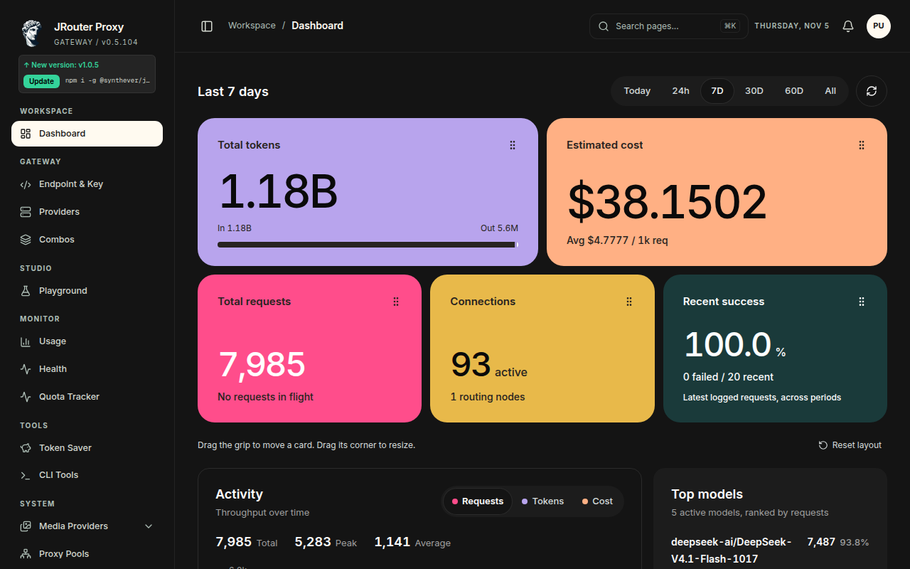
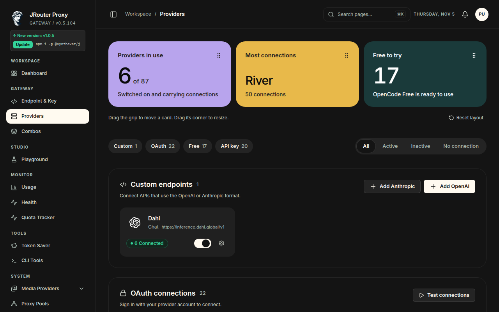
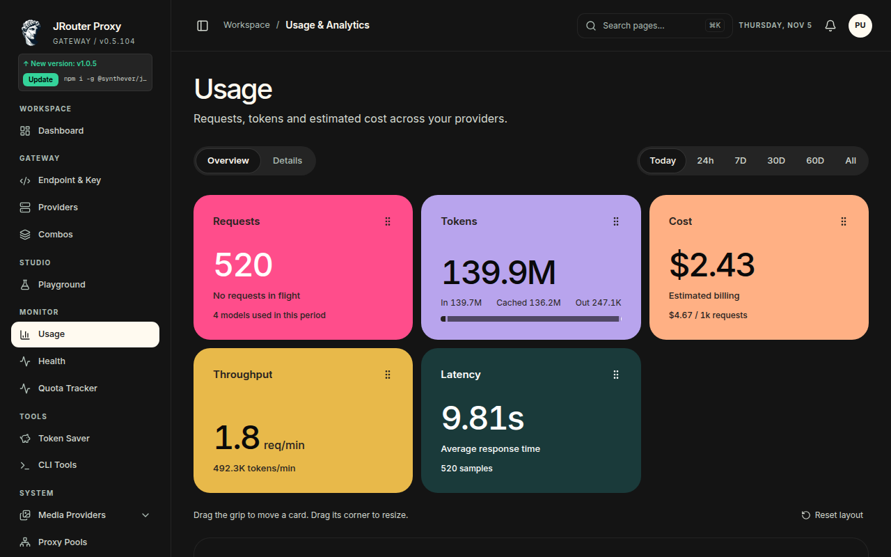
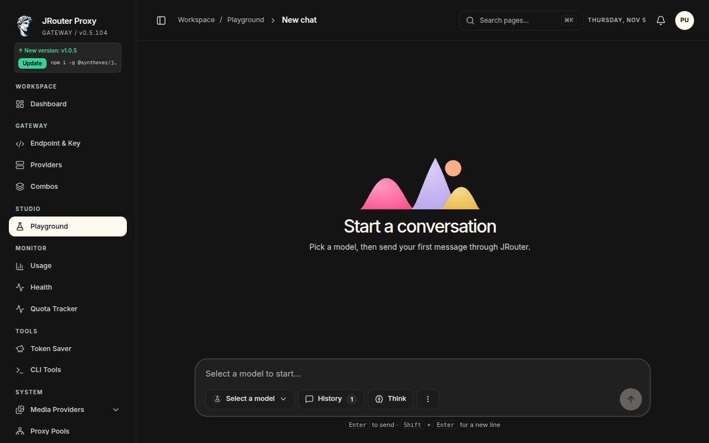

<div align="center">
  

  # JRouter: AI Router & Token Saver

  **Never stop coding. Save 20-40% tokens with RTK + auto-fallback to free and cheap AI models.**

  **Connect all AI coding tools (Claude Code, Cursor, Antigravity, Copilot, Codex, Gemini CLI, OpenCode, Cline, OpenClaw) to 140+ AI providers and models.**

  [](https://www.npmjs.com/package/@synthever/jrouter)
  [](./LICENSE)

  [🚀 Quick Start & Installation](#-quick-start--how-to-install) • [📸 Screenshots](#-screenshots) • [🎨 Redesigned UI Highlights](#-redesigned-ui-highlights) • [💡 Key Features](#-key-features) • [🌐 Supported Providers](#-supported-providers) • [📖 Setup Guide](#-setup-guide)

</div>

---

> **JRouter is a maintained fork of [9Router](https://github.com/decolua/9router)** by [decolua]. All credit for the original architecture goes upstream. JRouter adds: a redesigned Bento Grid dashboard with interactive 3D card tilt and draggable provider status tiles, a chat-first Playground workbench with dual-lane compare mode and JSON API inspection, scannable combos with custom model-IDs and key roles, move-on-error key demotion, sequential pool round-robin, WorkBuddy and River providers, model-namespace guards, orphan-model cleanup, backup and restore of enabled-model settings, API key extraction and bulk JSON import, per-key model restrictions, and an installable global CLI package (`npm i -g @synthever/jrouter`).

---

## 📸 Screenshots

<div align="center">
  
  <p><b>Dashboard</b>: Redesigned Bento Grid layout with interactive 3D card tilt, draggable provider status tiles, real-time telemetry (requests, tokens, success rate, active routing), and warm/dark theme tokens.</p>

  
  <p><b>Providers & Endpoints</b>: Real-time connection health, move-on-error demotion badges, sequential pool round-robin tracking, and one-click key extraction or bulk JSON import.</p>

  
  <p><b>Usage & Analytics</b>: Granular metrics including throughput KPIs (AVG REQ/MIN, AVG TOKENS/MIN), latency percentiles (p50, p95), and token consumption trends persisted into daily summaries.</p>

  
  <p><b>Playground</b>: Chat-first workbench with streaming turns, execution rail, live telemetry cards (active target, cache ratio, routing latency), dual-lane Compare mode, and JSON API inspector.</p>
</div>

---

## 🎨 Redesigned UI Highlights

The latest release of JRouter features a completely overhauled design system built for high-density developer workflows:

1. **Persistent Bento Grid Dashboard**:
   - Reconfigurable modular bento layouts that remember your preferred tile arrangements.
   - Interactive 3D card tilt and responsive lighting accents.
   - Draggable provider status chips for real-time monitoring at a glance.
   - Dual theme system: Warm cream paper (`#fffaf0`) for daylight clarity and deep dark (`#141414` / `#202020`) with hairline borders and pastel indicators.

2. **Chat-First Playground Workbench**:
   - Full-height workbench layout featuring live streaming turns and token counter.
   - Live telemetry KPI cards: Active target node, prompt cache ratio, and round-trip routing latency.
   - Execution rail: Parameter tuning without intrusive modal dialogs.
   - Compare Mode: Run two models side by side with parallel streaming lanes.
   - JSON API Inspector: View raw request payloads, response headers, and SSE events in real time.
   - Persistent conversation sessions stored safely in local storage with one-click export (Markdown, JSON, Python, cURL).

3. **Scannable Combos Management**:
   - Redesigned table layout with instant visibility of primary models and fallback sequences.
   - Support for Custom Model-IDs (`cmid`) and role gates (`owner` vs `user`).
   - Publication switches to expose selected combos to consumer API keys while keeping private routes hidden.

4. **Modular Settings & Profile**:
   - Quick jump navigation chips for immediate access to sections.
   - Modular panels for Preferences, Security, Routing, Network, Observability, SSO, and Backup & Restore.

---

## 🤔 Why JRouter?

**Stop wasting money, tokens, and hitting limits:**

- ❌ Subscription quota expires unused every month
- ❌ Rate limits stop you mid-coding
- ❌ Tool outputs (git diff, grep, ls, log dumps) burn prompt tokens rapidly
- ❌ Expensive individual API subscriptions ($20-50/month per provider)
- ❌ Manual switching between provider keys and configurations

**JRouter solves this:**

- ✅ **RTK Token Saver**: Auto-compress tool_result payloads, saving 20-40% tokens per request
- ✅ **Prompt Optimization**: Optional Caveman and Ponytail modes cut output verbosity up to 65%
- ✅ **Smart 3-Tier Fallback**: Automatic failover (Subscription -> Cheap -> Free) for zero downtime
- ✅ **Move-on-Error Demotion**: Automatically sort failing keys behind healthy keys without rewriting priority
- ✅ **Sequential Pool Round-Robin**: Strict 1 -> 2 -> 3 rotation across pool windows
- ✅ **Multi-Account Load Balancing**: Round-robin across accounts per provider
- ✅ **Universal Compatibility**: Works with Claude Code, Cursor, Codex, OpenClaw, Cline, and any OpenAI or Claude CLI tool

---

## 🔄 How It Works

```
┌─────────────┐
│  Your CLI   │  (Claude Code, Codex, OpenClaw, Cursor, Cline...)
│   Tool      │
└──────┬──────┘
       │ http://localhost:20128/v1
       ↓
┌─────────────────────────────────────────────┐
│           JRouter (Smart Router)            │
│  • RTK Token Saver (cut tool_result tokens) │
│  • Move-on-error key demotion               │
│  • Format translation (OpenAI <-> Claude)   │
│  • Quota tracking and latency KPIs          │
│  • Auto token refresh                       │
└──────┬──────────────────────────────────────┘
       │
       ├─> [Tier 1: SUBSCRIPTION] Claude Code, Codex, GitHub Copilot
       │   ↓ quota exhausted
       ├─> [Tier 2: CHEAP] GLM ($0.6/1M), MiniMax ($0.2/1M), Kimi
       │   ↓ budget limit
       └─> [Tier 3: FREE] Kiro, OpenCode Free, Vertex ($300 credits)

Result: Never stop coding, minimal cost + 20-40% token savings via RTK
```

---

## ⚡ Quick Start & How to Install

JRouter can be installed globally as a standalone CLI application, connected to existing tools remotely, run from source, deployed via PM2 as a background service, or launched inside a Docker container.

### Method 1: Global CLI Install (Recommended)

Install the global CLI using your preferred package manager:

```bash
# Using npm
npm install -g @synthever/jrouter

# Or using pnpm
pnpm add -g @synthever/jrouter

# Or using bun
bun add -g @synthever/jrouter
```

Start JRouter:

```bash
jrouter
```

The web dashboard opens automatically at `http://localhost:20128/dashboard`.

#### Interactive Terminal UI (TUI)

When run in an interactive terminal, `jrouter` provides an interactive Terminal UI to configure:
- **Providers**: Connect, test, and manage OAuth or API-key providers
- **Combos**: Build fallback and round-robin model cascades
- **API Keys**: Generate and restrict keys with custom model-IDs and roles
- **CLI Tools**: One-click setup for Claude Code, Codex, Cursor, and OpenClaw
- **Backup & Restore**: Export and import full database state including enabled models

#### CLI Command Options

```bash
jrouter                     # Start server and launch dashboard in browser
jrouter -p 3000             # Run on custom port (default: 20128)
jrouter --host 127.0.0.1    # Bind to loopback interface only (local-only)
jrouter --no-browser        # Start in headless mode without opening the browser
jrouter --log               # Stream server logs to stdout
jrouter --tray              # Minimize to system tray (macOS, Windows, Linux)
jrouter --skip-update       # Skip automatic npm update checks
jrouter --help              # Display full command help
```

---

### Method 2: Connect Local CLI Tools to a Remote JRouter

If you already have JRouter running on a server or VPS, you do not need to install the full server locally. You can configure your local CLI tools directly using `npx`:

```bash
# Interactively choose which tools to point to your remote JRouter:
npx @synthever/jrouter connect http://<your-server-ip>:20128

# Or configure specific tools directly:
npx @synthever/jrouter connect http://<your-server-ip>:20128 --tools claude,codex,cursor

# Inspect what your local CLI tools are currently pointed to:
npx @synthever/jrouter show

# Revert tools back to their previous configurations:
npx @synthever/jrouter connect --reset --tools claude,codex
```

Supported tools: `claude`, `codex`, `opencode`, `droid`, `crush`, `kilo`, `cline`, `pi`, `omp`, or `all`.

---

### Method 3: Run from Source (Repository Checkout)

To develop or run JRouter directly from source:

```bash
# 1. Clone repository
git clone https://github.com/Synthever/JRouter.git
cd JRouter

# 2. Install dependencies
npm install

# 3. Development server
PORT=20128 NEXT_PUBLIC_BASE_URL=http://localhost:20128 npm run dev

# 4. Production build and execution
export MAKEFLAGS="-j1"
npm run build
npm start
```

Default endpoints:
- Dashboard: `http://localhost:20128/dashboard`
- OpenAI-compatible API: `http://localhost:20128/v1`

---

### Method 4: Production Deployment via PM2 (VPS / Linux)

For 24/7 background operation on Linux servers:

```bash
git clone https://github.com/Synthever/JRouter.git
cd JRouter
npm install
npm run build

# Install PM2 globally
npm install -g pm2

# Start custom-server under PM2
pm2 start custom-server.js --name jrouter -- --port 20128

# Save process list and enable boot startup
pm2 save
pm2 startup
```

---

### Method 5: Docker Container

Run JRouter in an isolated Docker container with persistent data:

```bash
# Build the Docker image
docker build -t jrouter .

# Run container with volume persistence
docker run -d \
  -p 20128:20128 \
  -v "$HOME/.9router:/app/data" \
  -e DATA_DIR=/app/data \
  --name jrouter \
  jrouter
```

Or use docker-compose:

```bash
docker compose up -d
```

---

## 📺 Video Guides

Tutorials for setting up and maximizing routing efficiency (JRouter works following the same principles):

<div align="center">

<table>
  <tr>
    <td align="center" width="320">
      <a href="https://www.youtube.com/watch?v=CkVZZUSTXAI">
        
      </a><br/>
      <b>🇮🇩 Indonesia</b><br/>
      <sub>Koding 24 Jam Anti Rate Limit! Hemat Token AI 65% | Tutorial Quick Setup 🚀<br/>by <a href="https://www.youtube.com/@krisswuh">Krisswuh</a></sub>
    </td>
    <td align="center" width="320">
      <a href="https://www.youtube.com/watch?v=TXGv4eofe1I">
        
      </a><br/>
      <b>🇮🇩 Indonesia</b><br/>
      <sub>Cara Deploy di Hugging Face GRATIS Non-Stop! | Alternatif VPS RAM 16GB<br/>by <a href="https://www.youtube.com/@krisswuh">Krisswuh</a></sub>
    </td>
    <td align="center" width="320">
      <a href="https://www.youtube.com/watch?v=hgnE7MKi3Y4">
        
      </a><br/>
      <b>🇮🇩 Indonesia</b><br/>
      <sub>Bye Limit! Cara Bikin Sistem "AI Unlimited" 100% Gratis!<br/>by <a href="https://www.youtube.com/@neptiver">neptiver</a></sub>
    </td>
  </tr>
  <tr>
    <td align="center" width="320">
      <a href="https://www.youtube.com/watch?v=raEyZPg5xE0">
        
      </a><br/>
      <b>🇺🇸 English</b><br/>
      <sub>Claude Code FREE Setup Guide<br/>by <a href="https://www.youtube.com/@BuildAIWithHamid">Build AI With Hamid</a></sub>
    </td>
    <td align="center" width="320">
      <a href="https://www.youtube.com/watch?v=X69n5Lm06Yw">
        
      </a><br/>
      <b>🇻🇳 Tiếng Việt</b><br/>
      <sub>Cost Saving LLM for OpenClaw<br/>by <a href="https://www.youtube.com/c/M%C3%ACAIblog">Mì AI</a></sub>
    </td>
    <td align="center" width="320"></td>
  </tr>
</table>

</div>

---

## 🛠️ Supported CLI Tools

JRouter works seamlessly with all major AI coding tools:

<div align="center">
  <table>
    <tr>
      <td align="center" width="120">
        <br/>
        <b>Claude-Code</b>
      </td>
      <td align="center" width="120">
        <br/>
        <b>OpenClaw</b>
      </td>
      <td align="center" width="120">
        <br/>
        <b>Codex</b>
      </td>
      <td align="center" width="120">
        <br/>
        <b>OpenCode</b>
      </td>
      <td align="center" width="120">
        <br/>
        <b>Cursor</b>
      </td>
      <td align="center" width="120">
        <br/>
        <b>Antigravity</b>
      </td>
    </tr>
    <tr>
      <td align="center" width="120">
        <br/>
        <b>Cline</b>
      </td>
      <td align="center" width="120">
        <br/>
        <b>Continue</b>
      </td>
      <td align="center" width="120">
        <br/>
        <b>Droid</b>
      </td>
      <td align="center" width="120">
        <br/>
        <b>Roo</b>
      </td>
      <td align="center" width="120">
        <br/>
        <b>Copilot</b>
      </td>
      <td align="center" width="120">
        <br/>
        <b>Kilo Code</b>
      </td>
    </tr>
  </table>
</div>

---

## 🌐 Supported Providers

### 🔐 OAuth Providers

<div align="center">
  <table>
    <tr>
      <td align="center" width="120">
        <br/>
        <b>Claude-Code</b>
      </td>
      <td align="center" width="120">
        <br/>
        <b>Antigravity</b>
      </td>
      <td align="center" width="120">
        <br/>
        <b>Codex</b>
      </td>
      <td align="center" width="120">
        <br/>
        <b>GitHub</b>
      </td>
      <td align="center" width="120">
        <br/>
        <b>WorkBuddy</b>
      </td>
      <td align="center" width="120">
        <br/>
        <b>CodeBuddy</b>
      </td>
    </tr>
  </table>
</div>

### 🆓 Free Providers

<div align="center">
  <table>
    <tr>
      <td align="center" width="150">
        <br/>
        <b>Kiro AI</b><br/>
        <sub>Claude 4.5 + GLM-5 + MiniMax<br/>50 credits/month free</sub>
      </td>
      <td align="center" width="150">
        <br/>
        <b>OpenCode Free</b><br/>
        <sub>No auth, auto-fetch models<br/>Free (model list varies)</sub>
      </td>
      <td align="center" width="150">
        <br/>
        <b>Vertex AI</b><br/>
        <sub>Gemini 3 Pro + GLM-5 + DeepSeek<br/>$300 credits free</sub>
      </td>
    </tr>
  </table>
</div>

### 🔑 API Key Providers (40+)

<div align="center">
  <table>
    <tr>
      <td align="center" width="100">
        <br/>
        <sub>OpenRouter</sub>
      </td>
      <td align="center" width="100">
        <br/>
        <sub>River</sub>
      </td>
      <td align="center" width="100">
        <br/>
        <sub>GLM</sub>
      </td>
      <td align="center" width="100">
        <br/>
        <sub>Kimi</sub>
      </td>
      <td align="center" width="100">
        <br/>
        <sub>MiniMax</sub>
      </td>
      <td align="center" width="100">
        <br/>
        <sub>OpenAI</sub>
      </td>
    </tr>
    <tr>
      <td align="center" width="100">
        <br/>
        <sub>Anthropic</sub>
      </td>
      <td align="center" width="100">
        <br/>
        <sub>DeepSeek</sub>
      </td>
      <td align="center" width="100">
        <br/>
        <sub>Groq</sub>
      </td>
      <td align="center" width="100">
        <br/>
        <sub>xAI</sub>
      </td>
      <td align="center" width="100">
        <br/>
        <sub>Mistral</sub>
      </td>
      <td align="center" width="100">
        <br/>
        <sub>NVIDIA</sub>
      </td>
    </tr>
  </table>
  <p><i>...and 20+ more including Together, Fireworks, Cerebras, SiliconFlow, BeatAPI, and custom OpenAI/Anthropic-compatible endpoints</i></p>
</div>

> **JRouter extras**: `workbuddy` (GLM/DeepSeek/Kimi/MiniMax via workbuddy.ai) and `river` are JRouter additions, plus **bulk key management**: export all connection keys of a provider as JSON (*Extract Keys*) and import them on another provider (*Add Key -> Import JSON*).

### 🏠 Self-hosted Providers

For speech and embeddings served from your own machine: whisper.cpp, faster-whisper, Kokoro-FastAPI, openedai-speech, llama.cpp/llama-server, vLLM, Infinity, or any OpenAI-compatible server.

| Provider | Endpoint used | Typical server |
| --- | --- | --- |
| **Self-hosted STT** | `/v1/audio/transcriptions` | whisper.cpp, faster-whisper |
| **Self-hosted TTS** | `/v1/audio/speech` | Kokoro-FastAPI, openedai-speech |
| **Self-hosted Embedding** | `/v1/embeddings` | llama-server, vLLM, Infinity |

Each of these reads its address from each connection (`providerSpecificData.baseUrl`), so one provider can front several machines and load-balance across them.

---

## 💡 Key Features

| Feature | What It Does | Why It Matters |
| --- | --- | --- |
| 🚀 **RTK Token Saver** ([RTK](https://github.com/rtk-ai/rtk)) | Compress tool outputs (`git diff`, `grep`, `ls`, `tree`) before LLM | Save **20-40% input tokens** per request |
| 🪨 **Caveman Mode** ([Caveman](https://github.com/JuliusBrussee/caveman)) | Terse, technical responses without fluff | Save **up to 65% output tokens** |
| 🐴 **Ponytail** ([Ponytail](https://github.com/DietrichGebert/ponytail)) | "Lazy senior dev" prompt: minimal, YAGNI-first code | Fewer output tokens, cleaner diffs |
| 🎯 **Smart 3-Tier Fallback** | Auto-route: Subscription -> Cheap -> Free | Never stop coding, zero downtime |
| 📉 **Move-on-Error Demotion** | Sort failing keys behind healthy keys dynamically | Avoid re-hitting broken or empty keys |
| 🔄 **Sequential Pool Round-Robin** | Strict 1 -> 2 -> 3 rotation across pool windows | True uniform load distribution |
| 🔐 **Custom Model-IDs & Role Gates** | Restrict user-role keys to published combo names | Production multi-tenant safety |
| 📊 **Real-Time Throughput & Latency KPIs** | AVG REQ/MIN, AVG TOKENS/MIN, p50/p95 latency metrics | Accurate performance monitoring |
| 🔄 **Universal Format Translation** | OpenAI <-> Claude <-> Gemini <-> Cursor <-> Kiro <-> Vertex | Works with any CLI tool |
| 👥 **Multi-Account Support** | Multiple credentials per provider | Redundancy and rate-limit bypassing |
| 💾 **Backup/Restore with Model Settings** | Full database export/import preserving enabled-model state | Move configurations cleanly |
| 📥 **Key Extract & Import** | Export keys as JSON, bulk-import across providers | Migrate credentials in seconds |

Set header `X-9Router-Token-Saver: off` to bypass token savers for an individual request.

<details>
<summary><b>📖 Feature Details</b></summary>

### 🚀 RTK Token Saver

Tool outputs (`git diff`, `grep`, `find`, `ls`, `tree`, log dumps) often eat 30-50% of your prompt budget. RTK detects them and applies smart, lossless compression before the request hits the LLM:

- **Filters**: `git-diff`, `git-status`, `grep`, `find`, `ls`, `tree`, `dedup-log`, `smart-truncate`, `read-numbered`, `search-list`
- **Auto-detect**: No config needed. RTK peeks the first 1KB of each `tool_result` and picks the right filter.
- **Safe by design**: If a filter fails, throws, or makes output bigger, RTK silently keeps the original text. Errors never break your request.
- **Universal**: Works across all formats (OpenAI, Claude, Gemini, Cursor, Kiro, OpenAI Responses) because it runs before any format translation.
- **Default ON**: Toggle anytime in Dashboard -> Endpoint settings.

```
Without RTK: 47K tokens sent to LLM
With RTK:    28K tokens sent to LLM   (40% saved, same context, same answer)
```

### 🐴 Ponytail (Lazy Senior Dev)

Ponytail injects a "lazy senior dev" system prompt into every request, biasing the LLM toward minimal, YAGNI-first code: deletion over addition, stdlib over new deps, one-liners over abstractions. Adapted from [DietrichGebert/ponytail](https://github.com/DietrichGebert/ponytail).

- **Lite**: Build what is asked, name the lazier alternative.
- **Full**: YAGNI ladder enforced: stdlib -> native -> existing deps -> one-liner -> minimal code.
- **Ultra**: YAGNI extremist: deletion first, ship the one-liner, challenge the rest of the requirement in the same response.

```
Without Ponytail: verbose code, extra abstractions, "just in case" scaffolding
With Ponytail:    shortest working diff, no unrequested abstractions, fewer tokens
```

Never trades away: input validation, error handling that prevents data loss, security, accessibility, or anything explicitly requested. Enable in Dashboard -> Endpoint -> Ponytail.

### 🎯 Smart 3-Tier Fallback

Create combos with automatic fallback:

```
Combo: "my-coding-stack"
  1. cc/claude-opus-4-6        (your subscription)
  2. glm/glm-4.7               (cheap backup, $0.6/1M)
  3. if/kimi-k2-thinking       (free fallback)

-> Auto switches when quota runs out or errors occur
```

### 📉 Move-on-Error Demotion

A failing key is flagged and sorted behind every healthy key for that provider until its next successful call clears the flag. Your curated priority order is never rewritten: it is a runtime overlay, so a recovered key returns to its original slot. Per-provider toggle, on by default. Payload-caused 4xx errors (400, 404, 413, 422) never demote because the credential itself is not at fault.

### 🔄 Sequential Pool Round-Robin

Strict `1 -> 2 -> 3 -> 1` rotation over a configurable pool window, demotion-aware: a demoted key sinks out of the window and a recovered key re-enters at its curated position. The cursor is identity-based, so changing pool membership re-anchors instead of skipping a key.

### 🔐 Custom Model-IDs & Key Role Gates

Combos can be published under a clean, custom model identifier (e.g. `fast-code` or `synth-agent`). API keys can be designated with an `owner` role (full access) or a `user` role. User-role keys are restricted strictly to explicitly published custom model-IDs, making JRouter ready for team or client sharing.

### 💾 Backup / Restore with Model Settings

Download the full database as JSON from Dashboard -> Settings. The export includes per-provider **enabled/disabled model lists**, so a restore brings every provider back exactly as configured: no models reset to defaults.

### 📥 Extract Keys & Import JSON

On any API-key provider: **Connections -> Extract Keys** downloads `keys-<providerId>.json`. On another provider: **Add Key -> Import JSON** parses that file, validates each key, and bulk-adds the active ones.

### 🔄 Format Translation

Seamless translation between formats:
- **OpenAI** <-> **Claude** <-> **Gemini** <-> **Cursor** <-> **Kiro** <-> **Vertex** <-> **Antigravity** <-> **Ollama** <-> **OpenAI Responses**
- Your CLI tool sends OpenAI format -> JRouter translates -> Provider receives native format

### 📊 Real-Time Quota Tracking & Latency Metrics

- Token consumption per provider
- Reset countdown (5-hour, daily, weekly)
- Throughput and latency percentiles (AVG REQ/MIN, AVG TOKENS/MIN, p50, p95) persisted into daily summaries
- Cost estimation for tracking and comparison

</details>

---

## 💰 Pricing & Provider Tiers

| Tier | Provider | Cost | Quota Reset | Best For |
| --- | --- | --- | --- | --- |
| **🚀 TOKEN SAVER** | **RTK (built-in)** | **FREE** | Always on | Save 20-40% tokens on every request |
| **💳 SUBSCRIPTION** | Claude Code (Pro/Max) | $20-200/mo | 5h + weekly | Active Anthropic subscribers |
| | Codex (Plus/Pro) | $20-200/mo | 5h + weekly | Active OpenAI subscribers |
| | GitHub Copilot | $10-19/mo | Monthly | Active GitHub users |
| **💰 CHEAP** | GLM-5.1 / GLM-4.7 | $0.6/1M | Daily 10AM | Budget backup coding |
| | MiniMax M2.7 | $0.2/1M | 5-hour rolling | Lowest cost per token |
| | Kimi K2.5 | $9/mo flat | 10M tokens/mo | Predictable monthly cost |
| **🆓 FREE** | Kiro AI | $0 | 50 credits/mo | Claude 4.5 + GLM-5 + MiniMax |
| | OpenCode Free | $0 | Varies | Zero-auth passthrough |
| | Vertex AI | $300 credits | New GCP accounts | Gemini 3 Pro + DeepSeek |

**💡 Pro Tip**: RTK + Kiro AI + OpenCode Free combo = **$0 cost + 20-40% token savings**!

---

## ❓ Frequently Asked Questions

<details>
<summary><b>📊 Why does my dashboard show high costs?</b></summary>

The dashboard tracks your token usage and displays **estimated costs** as if you were using paid APIs directly. This is **not actual billing**: it is a reference metric showing how much you are saving by routing through free models or existing subscriptions.

**Example:**
- **Dashboard shows:** "$290 total cost"
- **Reality:** You are using Kiro free models (50 credits/month)
- **Your actual cost:** **$0.00**
- **What $290 means:** Total estimated value of tokens saved!

</details>

<details>
<summary><b>💳 Will I be charged by JRouter?</b></summary>

**No.** JRouter is free, open-source software that runs on your own machine or server. It never charges you. You only pay upstream providers directly when using paid accounts or API keys.
</details>

<details>
<summary><b>🔀 How is JRouter different from upstream 9Router?</b></summary>

JRouter is an advanced, maintained fork of 9Router adding:
- Redesigned Bento Grid dashboard with interactive 3D card tilt and draggable status tiles
- Chat-first Playground workbench with execution rail, KPI cards, Compare mode, and JSON API inspector
- Scannable Combos table with Custom Model-IDs (`cmid`) and role gates (`owner` vs `user`)
- Move-on-error key demotion for resilient routing
- Sequential pool round-robin load balancing
- WorkBuddy and River provider integrations
- Backup and restore preserving per-provider enabled/disabled model settings
- Bulk key extraction and JSON import
- Per-key model allow/deny lists
- Installable global CLI package `@synthever/jrouter` with Terminal UI (TUI)
</details>

<details>
<summary><b>🖥️ Can JRouter run alongside upstream 9Router?</b></summary>

Yes, but not on the same port or data directory simultaneously. Both default to port `20128` and `~/.9router`. Run `jrouter -p <other-port>` to run a separate instance.
</details>

<details>
<summary><b>🆓 Are FREE providers really free?</b></summary>

Yes, within their limits: **Kiro** ~50 credits/month, **OpenCode Free** no-auth passthrough, **Vertex AI** $300 free credits for new GCP accounts. JRouter simply routes your requests without additional charges.
</details>

---

## 📖 Setup Guide

<details>
<summary><b>🔐 Subscription Providers</b></summary>

### Claude Code (Pro/Max)

```bash
Dashboard -> Providers -> Connect Claude Code
-> OAuth login -> Auto token refresh
-> 5-hour + weekly quota tracking

Models:
  cc/claude-opus-4-7
  cc/claude-opus-4-6
  cc/claude-sonnet-4-6
  cc/claude-haiku-4-5-20251001
```

### OpenAI Codex (Plus/Pro)

```bash
Dashboard -> Providers -> Connect Codex
-> OAuth login -> 5-hour + weekly reset

Models:
  cx/gpt-5.5
  cx/gpt-5.3-codex
```

### GitHub Copilot

```bash
Dashboard -> Providers -> Connect GitHub
-> OAuth via GitHub -> Monthly reset

Models:
  gh/gpt-5.4
  gh/claude-opus-4.7
  gh/grok-code-fast-1
```

### WorkBuddy (JRouter addition)

```bash
Dashboard -> Providers -> Connect WorkBuddy
-> OAuth device login at workbuddy.ai

Models:
  wb/glm-5.2
  wb/deepseek-v4.1-flash
  wb/kimi-k2.7
  wb/minimax-m3
```

</details>

<details>
<summary><b>💰 Cheap Providers</b></summary>

### GLM-5.1 / GLM-4.7 ($0.6/1M)

1. Sign up: [Zhipu AI](https://open.bigmodel.cn/)
2. Get API key from Coding Plan
3. Dashboard -> Add API Key -> Provider: `glm`

**Use**: `glm/glm-5.1`, `glm/glm-5`, `glm/glm-4.7`

### MiniMax M2.7 ($0.20/1M)

1. Sign up: [MiniMax](https://www.minimax.io/)
2. Get API key -> Dashboard -> Add API Key

**Use**: `minimax/MiniMax-M2.7`

### Kimi K2.5 ($9/month flat)

1. Subscribe: [Moonshot AI](https://platform.moonshot.ai/)
2. Get API key -> Dashboard -> Add API Key

**Use**: `kimi/kimi-k2.5`, `kimi/kimi-k2.5-thinking`

</details>

<details>
<summary><b>🆓 FREE Providers</b></summary>

### Kiro AI (Claude 4.5 + GLM-5 + MiniMax FREE)

```bash
Dashboard -> Connect Kiro
-> AWS Builder ID, Google, or GitHub OAuth

Models:
  kr/claude-sonnet-4.5
  kr/glm-5
  kr/MiniMax-M2.5
```

### OpenCode Free (No auth, auto-fetch models)

```bash
Dashboard -> Connect OpenCode Free
-> No login required (passthrough proxy)
```

### Vertex AI ($300 free credits for new GCP accounts)

```bash
Dashboard -> Connect Vertex AI
-> Upload Google Cloud Service Account JSON

Models:
  vertex/gemini-3.1-pro-preview
  vertex-partner/glm-5-maas
  vertex-partner/deepseek-v3.2-maas
```

</details>

<details>
<summary><b>🎨 Creating Combos & Fallbacks</b></summary>

```
Dashboard -> Combos -> Create New

Name: premium-coding
Models:
  1. cc/claude-opus-4-7 (Subscription primary)
  2. glm/glm-5.1 (Cheap backup, $0.6/1M)
  3. minimax/MiniMax-M2.7 (Cheapest fallback, $0.20/1M)

Use in CLI: premium-coding
```

Strategy options:
- **Fallback**: Chain from primary to secondary to tertiary on failure or quota exhaustion
- **Round-robin**: Uniformly distribute requests across selected models
- **Fusion**: Query all panelists concurrently and synthesize the best output using a judge model

</details>

<details>
<summary><b>🔧 CLI Tool Integration Examples</b></summary>

### Cursor IDE

```
Settings -> Models -> Advanced:
  OpenAI API Base URL: http://localhost:20128/v1
  OpenAI API Key: [copy from JRouter dashboard]
  Model: cc/claude-opus-4-7
```

### Claude Code

Edit `~/.claude/config.json`:

```json
{
  "anthropic_api_base": "http://localhost:20128/v1",
  "anthropic_api_key": "your-jrouter-api-key"
}
```

### Codex CLI

```bash
export OPENAI_BASE_URL="http://localhost:20128"
export OPENAI_API_KEY="your-jrouter-api-key"

codex "your prompt"
```

### OpenClaw

Edit `~/.openclaw/openclaw.json`:

```json
{
  "agents": {
    "defaults": {
      "model": {
        "primary": "jrouter/kr/claude-sonnet-4.5"
      }
    }
  },
  "models": {
    "providers": {
      "jrouter": {
        "baseUrl": "http://127.0.0.1:20128/v1",
        "apiKey": "sk_jrouter",
        "api": "openai-completions",
        "models": [
          {
            "id": "kr/claude-sonnet-4.5",
            "name": "Claude Sonnet 4.5 (Kiro Free)"
          }
        ]
      }
    }
  }
}
```

> **Note**: Use `127.0.0.1` instead of `localhost` to avoid IPv6 resolution issues.

### Cline / Continue / RooCode

```
Provider: OpenAI Compatible
Base URL: http://localhost:20128/v1
API Key: [from dashboard]
Model: cc/claude-opus-4-7
```

</details>

---

## 🚀 Deployment & Configuration

### Environment Variables

| Variable | Default | Description |
| --- | --- | --- |
| `PORT` | `20128` | Port where JRouter listens |
| `HOSTNAME` | `0.0.0.0` | Bind host address |
| `DATA_DIR` | `~/.9router` | SQLite database and credential directory |
| `JWT_SECRET` | Auto-generated | Secret for dashboard auth tokens (`~/.9router/jwt-secret`) |
| `INITIAL_PASSWORD` | `123456` | Default password for initial dashboard login |
| `NODE_ENV` | `production` | Environment mode |
| `REQUIRE_API_KEY` | `false` | Enforce API key on all `/v1/*` routes |
| `AUTH_COOKIE_SECURE` | `false` | Set to true when running behind HTTPS proxy |
| `ENABLE_REQUEST_LOGS` | `false` | Write full request/response payloads to disk |
| `HTTP_PROXY`, `HTTPS_PROXY` | empty | Outbound proxy for upstream provider requests |

### Runtime Storage Layout

- Main state database: `${DATA_DIR}/db/data.sqlite` (SQLite: providers, combos, keys, settings, metrics)
- Automated backups: `${DATA_DIR}/db/backups/`
- Request telemetry logs: `${DATA_DIR}/logs/` when `ENABLE_REQUEST_LOGS=true`

---

## 📊 Available Models

<details>
<summary><b>View model prefix reference</b></summary>

**Claude Code (`cc/`)**:
- `cc/claude-opus-4-7`, `cc/claude-opus-4-6`, `cc/claude-sonnet-4-6`, `cc/claude-haiku-4-5-20251001`

**Codex (`cx/`)**:
- `cx/gpt-5.5`, `cx/gpt-5.4`, `cx/gpt-5.3-codex`

**GitHub Copilot (`gh/`)**:
- `gh/gpt-5.4`, `gh/claude-opus-4.7`, `gh/grok-code-fast-1`

**GLM (`glm/`)**:
- `glm/glm-5.1`, `glm/glm-5`, `glm/glm-4.7`

**Kiro (`kr/`)**:
- `kr/claude-sonnet-4.5`, `kr/glm-5`, `kr/MiniMax-M2.5`

**WorkBuddy (`wb/`)**:
- `wb/glm-5.2`, `wb/deepseek-v4.1-flash`, `wb/kimi-k2.7`, `wb/minimax-m3`

**OpenRouter (`openrouter/`)**:
- 240+ live catalog models configured via Dashboard -> Providers -> OpenRouter

</details>

---

## 🐛 Troubleshooting

<details>
<summary><b>Common Issues & Solutions</b></summary>

**"Language model did not provide messages"**
- Provider quota exhausted. Check dashboard quota tracker.
- Solution: Use combo fallback or switch to cheaper/free tier.

**OAuth token expired**
- Auto-refreshed automatically by JRouter background worker.
- If issues persist: Dashboard -> Providers -> Reconnect.

**Dashboard opens on wrong port**
- Set `PORT=20128` and `NEXT_PUBLIC_BASE_URL=http://localhost:20128`.

**First login password rejected**
- Check `INITIAL_PASSWORD` in your environment or `.env`.
- If unset, the default fallback password is `123456`.

**No request logs written**
- Ensure `ENABLE_REQUEST_LOGS=true` is set.

</details>

---

## 🛠️ Tech Stack

- **Runtime**: Node.js 20+
- **Framework**: Next.js 16
- **UI Engine**: React 19, Tailwind CSS 4, Motion, Lucide Icons
- **Database**: SQLite (automatic fallback chain: bun:sqlite -> better-sqlite3 -> node:sqlite -> sql.js)
- **Streaming**: Server-Sent Events (SSE) with HTTP/2 and h2c upgrade handling
- **Authentication**: OAuth 2.0 (PKCE) + JWT + Role-based API Keys

---

## 📝 API Reference

### Chat Completions

```bash
POST http://localhost:20128/v1/chat/completions
Authorization: Bearer <your-jrouter-key>
Content-Type: application/json

{
  "model": "cc/claude-opus-4-6",
  "messages": [
    {"role": "user", "content": "Write a clean binary search in Rust"}
  ],
  "stream": true
}
```

### List Models

```bash
GET http://localhost:20128/v1/models
Authorization: Bearer <your-jrouter-key>
```

Returns all enabled models and published combos matching the requesting key's role and allowed-models policy.

---

## 🙏 Acknowledgments

JRouter is built on the foundation of **[9Router](https://github.com/decolua/9router)** by **decolua**: sincere thanks to the original project and its community. Token saving and prompt optimization build on:

- **[CLIProxyAPI](https://github.com/router-for-me/CLIProxyAPI)**: Original Go implementation that inspired this architecture.
- **[RTK](https://github.com/rtk-ai/rtk)**: High-performance token-saver pipeline ported to JS for 20-40% prompt compression.
- **[Caveman](https://github.com/JuliusBrussee/caveman)**: Terse output prompt engineering for up to 65% output token reduction.
- **[Ponytail](https://github.com/DietrichGebert/ponytail)**: Pragmatic YAGNI engineering prompts for cleaner diffs and fewer output tokens.

---

## 📄 License

MIT License. See [LICENSE](LICENSE) for details.

---

<div align="center">
  <sub>Built with ❤️ for developers who code 24/7</sub>
</div>
